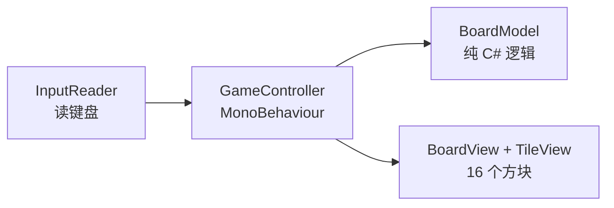

# 02　把 v2.0 的算法搬进 Unity

这一章是整份教程的核心：让方向键真的能移动和合并方块。

## 2.1 先把"逻辑"和"表现"分开

控制台版里逻辑和表现共用一份数据：`MoveMap` 改 `s_map`，`ShowMap` 直接读 `s_map` 画出来——因为屏幕上只有文本，数据一改屏幕自然就对了。

Unity 里不行：屏幕上是 16 个**真实对象**，它们不会自动知道数据变了。所以要分三层：

| 层 | 类型 | 职责 | 依赖 Unity |
| --- | --- | --- | --- |
| **Model** `BoardModel` | 普通 C# 类 | 棋盘数据 + 移动/合并/判定 | **不依赖**，能脱离 Unity 跑 |
| **View** `BoardView` / `TileView` | MonoBehaviour | 把数字画成方块 | 依赖 |
| **Controller** `GameController` | MonoBehaviour | 读输入、调 Model、调 View | 依赖 |



三个实打实的好处：

1. **算法能原样复用**：`MergeLine` 你在控制台版已用 625 种组合验证过，搬过来只改一行
2. **调试简单**：逻辑错就是逻辑错，不会和"对象位置不对"混在一起
3. **以后好扩展**：加撤销、存盘、联机对战，都只动 Model

## 2.2 数据结构：一处刻意的改动

v2.0 里你用**指数**存方块（1 表示 2、11 表示 2048），合并就是指数 +1，显示时 `1 << 指数`。

Unity 版建议**直接存显示值**（2、4、8……）：

- 2048 实战 01的 `TileView.SetValue(int)` 接收的就是显示值，逻辑层也用显示值就不用转换
- 调试时看 `board` 一目了然（`{2,4,8}` 比 `{1,2,3}` 直观）
- 少一个转换点，少一类"忘了转换"的 bug

**代价只有一处**：合并时从 `++result[write - 1]` 改成 `result[write - 1] *= 2`。

> 想保留指数表示也行：把 `MergeLine` 里那一行和 `TileView.SetValue` 开头改回 `1 << value` 即可，其余不用动。

## 2.3 Model：纯逻辑，不引用 UnityEngine

新建 `Scripts/BoardModel.cs`：

```csharp
using System;

/// <summary>
/// 棋盘逻辑：纯 C# 类，不引用 UnityEngine，所以能被单元测试直接测。
/// </summary>
public class BoardModel
{
    public const int Size = 4;

    private readonly int[,] _board = new int[Size, Size];
    private readonly Random _random = new Random();

    /// <summary>只读的棋盘数据：外部只能看，不能改。</summary>
    public int[,] Board => _board;

    /// <summary>清空棋盘并放两个初始方块。</summary>
    public void Reset()
    {
        for (int x = 0; x < Size; x++)
        {
            for (int y = 0; y < Size; y++)
            {
                _board[x, y] = 0;
            }
        }

        AddRandomTile();
        AddRandomTile();
    }

    /// <summary>在随机空格放一个方块（90% 是 2，10% 是 4）。满盘则什么都不做。</summary>
    public void AddRandomTile()
    {
        // 先数空格、再随机挑一个：比"随机猜位置直到命中"稳，永不死循环
        int emptyCount = 0;
        for (int x = 0; x < Size; x++)
        {
            for (int y = 0; y < Size; y++)
            {
                if (_board[x, y] == 0) emptyCount++;
            }
        }

        if (emptyCount == 0) return;

        int target = _random.Next(emptyCount);
        for (int x = 0; x < Size; x++)
        {
            for (int y = 0; y < Size; y++)
            {
                if (_board[x, y] != 0) continue;
                if (target-- == 0)
                {
                    _board[x, y] = _random.Next(10) == 0 ? 4 : 2;
                    return;
                }
            }
        }
    }

    /// <summary>朝某方向移动。返回 true 表示棋盘真的变了（据此决定要不要放新方块）。</summary>
    public bool Move(Direction direction)
    {
        int[,] before = (int[,])_board.Clone();

        for (int line = 0; line < Size; line++)
        {
            WriteLine(direction, line, MergeLine(ReadLine(direction, line)));
        }

        return !SameAs(before);
    }

    /// <summary>还有地方能走吗（有空格，或存在相邻同值方块）。</summary>
    public bool CanMove()
    {
        for (int x = 0; x < Size; x++)
        {
            for (int y = 0; y < Size; y++)
            {
                if (_board[x, y] == 0) return true;
                if (x + 1 < Size && _board[x, y] == _board[x + 1, y]) return true;
                if (y + 1 < Size && _board[x, y] == _board[x, y + 1]) return true;
            }
        }

        return false;
    }

    /// <summary>棋盘上最大的数字（本局最高）。</summary>
    public int MaxValue()
    {
        int max = 0;
        for (int x = 0; x < Size; x++)
        {
            for (int y = 0; y < Size; y++)
            {
                if (_board[x, y] > max) max = _board[x, y];
            }
        }

        return max;
    }

    /// <summary>所有方块数字之和，可直接当分数。</summary>
    public int Sum()
    {
        int sum = 0;
        for (int x = 0; x < Size; x++)
        {
            for (int y = 0; y < Size; y++)
            {
                sum += _board[x, y];
            }
        }

        return sum;
    }
```

接下来是移动的核心，**思路和你的 v2.0 一模一样**：

```csharp
    /// <summary>按移动方向取出一条线，下标 0 是最靠近目标边缘的那格。</summary>
    private int[] ReadLine(Direction direction, int line)
    {
        int[] values = new int[Size];
        for (int position = 0; position < Size; position++)
        {
            (int x, int y) = GetCell(direction, line, position);
            values[position] = _board[x, y];
        }

        return values;
    }

    private void WriteLine(Direction direction, int line, int[] values)
    {
        for (int position = 0; position < Size; position++)
        {
            (int x, int y) = GetCell(direction, line, position);
            _board[x, y] = values[position];
        }
    }

    /// <summary>
    /// 四个方向共用一套映射：第 line 条线、线上第 position 格（0 = 目标边缘）对应的格坐标。
    /// board[x, y] 中 x 向右、y 向上，与 BoardView.GridToWorld 保持一致。
    /// </summary>
    private static (int x, int y) GetCell(Direction direction, int line, int position)
    {
        return direction switch
        {
            Direction.Left  => (position, line),
            Direction.Up    => (line, position),
            Direction.Right => (Size - 1 - position, line),
            Direction.Down  => (line, Size - 1 - position),
            _ => (0, 0),
        };
    }

    /// <summary>
    /// 单行压缩 + 合并：一次遍历，非零块依次填到前面，相邻且相等就合并。
    /// 与 v2.0 的 MergeLine 唯一区别：这里合并是 *2（显示值），那边是 ++（指数）。
    /// </summary>
    private static int[] MergeLine(int[] line)
    {
        int[] result = new int[Size];
        int write = 0;
        bool justMerged = false;      // 刚合并出来的块，这一轮不能再合并

        for (int read = 0; read < Size; read++)
        {
            if (line[read] == 0) continue;

            if (write > 0 && !justMerged && result[write - 1] == line[read])
            {
                result[write - 1] *= 2;
                justMerged = true;
            }
            else
            {
                result[write] = line[read];
                write++;
                justMerged = false;
            }
        }

        return result;
    }

    private bool SameAs(int[,] other)
    {
        for (int x = 0; x < Size; x++)
        {
            for (int y = 0; y < Size; y++)
            {
                if (_board[x, y] != other[x, y]) return false;
            }
        }

        return true;
    }
}
```

**和控制台版逐条对照**：

| 控制台 v2.0 | Unity 版 | 差异 |
| --- | --- | --- |
| `int[][] s_map` | `int[,] _board` | 交错数组 → 二维数组 |
| `ReadLine` / `WriteLine` / `GetCell` | 同名同逻辑 | 只是坐标轴命名变成 x 向右、y 向上 |
| `MergeLine`（指数 `++`） | `MergeLine`（显示值 `*2`） | 一行之差，见 2.2 |
| `AddRandomBlock`（填指数 1 或 2） | `AddRandomTile`（填 2 或 4，10% 出 4） | 顺手把概率写显式了 |
| `CanMove()` | `CanMove()` | 一样 |
| `GetCurrentBest()` / 历史最高 | `MaxValue()` / `Sum()` | 分数逻辑挪进 Model，历史最高留给2048 实战 04的存档 |

## 2.4 Controller：把三者串起来

新建 `Scripts/GameController.cs`——**它就相当于你控制台版里的 `Main` + `HandleKey`**：

```csharp
using UnityEngine;

/// <summary>
/// 每帧读输入、驱动 Model 运算、让 View 重画。相当于控制台版的 Main + HandleKey 循环。
/// </summary>
public class GameController : MonoBehaviour
{
    [SerializeField] private BoardView view;

    private BoardModel _model;

    void Awake()
    {
        _model = new BoardModel();
        _model.Reset();
    }

    void Start()
    {
        view.Refresh(_model.Board);
    }

    void Update()
    {
        // R：重开（控制台版里按 R 会先把本局最大值记入历史最高，这里留给2048 实战 04）
        if (Input.GetKeyDown(KeyCode.R))
        {
            _model.Reset();
            view.Refresh(_model.Board);
            return;
        }

        // 方向键 / WASD
        Direction? direction = InputReader.ReadDirection();
        if (direction == null) return;

        // 无效移动（整排都推不动）就什么都不做——不能生成新方块
        if (!_model.Move(direction.Value)) return;

        _model.AddRandomTile();
        view.Refresh(_model.Board);

        if (!_model.CanMove())
        {
            Debug.Log($"游戏结束！本局最大 {_model.MaxValue()}");
        }
    }
}
```

对照你 v2.0 的 `HandleKey`，逐行对应关系是：

| v2.0（控制台） | 这里（Unity） |
| --- | --- |
| `Console.ReadKey(true)` | `Update()` 每帧被引擎调用，`Input.GetKeyDown` 自己查 |
| `case ConsoleKey.R: RecordHistoryBest(); InitMap(); ...` | `if (Input.GetKeyDown(KeyCode.R))` 分支 |
| `MoveMap(direction)` | `_model.Move(direction)` |
| `if (!MapsEqual(before, s_map)) { AddRandomBlock(); }` | `if (!_model.Move(...)) return;` + `_model.AddRandomTile()` |
| `ShowMap()` | `view.Refresh(_model.Board)` |
| `CheckGameState()` | `if (!_model.CanMove())` |

注意 **`Move` 返回 bool 的用法**：`if (!_model.Move(dir)) return;` —— 一次调用既执行了移动，又告诉了你"这次算不算有效移动"。控制台版里你是靠 `beforeMap` + `MapsEqual` 手动比对的，这里把它封装进 Model 内部，Controller 不用再关心。

## 2.5 装配到场景并测试

1. 选中 Hierarchy 里的 `Board`
2. Add Component → `GameController`
3. 把 `Board` 自己（也就是那个挂了 `BoardView` 的对象）拖到 `GameController` 的 `view` 字段上
4. 运行，按方向键

**预期**：棋盘上出现两个方块（2 或 4），按方向键时它们整排移动、相同数字合并、每次有效移动后多出一个新方块；无效方向（比如都在最左边还按左）**不会**产生新方块。

## 2.6 出问题先查这三条

| 现象 | 原因 |
| --- | --- |
| 按方向键毫无反应 | `Update` 里的 `ReadDirection()` 没被调用？`GameController` 没挂上？`view` 引用没拖？ |
| 报 `NullReferenceException`，位置在 `view.Refresh` | `view` 字段是空的（`None`） |
| 方块动了但数字不对 / 合并错了 | 打印 `_model.Board` 看数据层，问题一定在 Model，不在 View |

**验证算法是否真的对**（这一步强烈建议做，控制台版你是用 625 种组合穷举验证的，Unity 里也能做）：

把 `BoardModel` 的 `Board` 暴露成只读，然后在测试脚本里直接构造数据：

```csharp
var model = new BoardModel();
// 手动摆一个 [2,2,2,2] 的局面 —— 正确结果是 [4,4,0,0]，不是 [8,0,0,0]
// 由于 Board 是只读引用，这里用反射或者给 Model 加一个 internal 的 SetForTest 方法
```

更省事的做法是：**给 `BoardModel` 加一个 `[Conditional]` 的测试入口**，或者干脆把 Model 复制到一个控制台项目里跑你原来那套 625 种组合的验证代码——因为 `BoardModel` 不依赖 Unity，**这份代码可以原样拿到控制台项目里跑单元测试**。这也是"逻辑与表现分离"最大的好处。

## 2.7 本章动手

1. 让 6.5 真的跑起来
2. 用反射或加临时方法，构造一个 `[2,2,2,2]` 的行，调用 `Move(Left)`，确认结果是 `[4,4,0,0]`（这是你在控制台版踩过的第一个坑）
3. 构造 `[2,2,0,2]` 确认得到 `[4,2,0,0]`（验证 `justMerged` 逻辑）
4. 加一个 `Z` 键撤销：在 `Update` 里按 Z 前先把 `_model.Board` 克隆一份存起来，按 Z 时还原（这是控制台版没有的新功能，也是 Model 层最容易扩展的地方）

**下一章**：让移动有动画、加分数 UI 和音效——从"能玩"到"像个游戏"。
