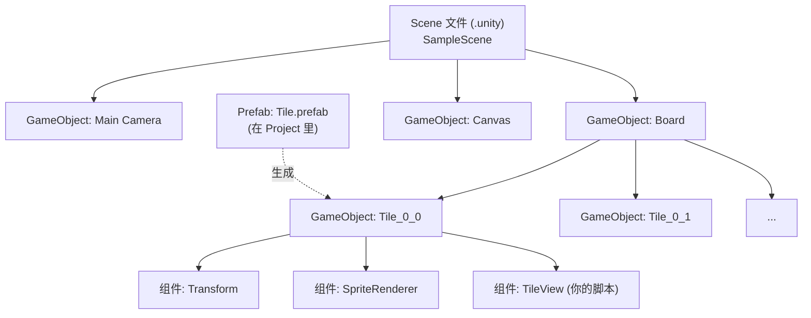

# 03　对象与资源模型：GameObject、Component、Prefab

这一章是整份教程里最重要的一章。你以后 90% 的"这为什么不动"都能追溯到这三个词的关系没搞清楚。

## 3.1 GameObject 只是个"空壳"

在 Hierarchy 里新建一个对象（右键 → Create Empty），它就是一个 **GameObject**。它自己什么都不是，只有四样东西：

- **名字**
- **Tag / Layer**（分类用，碰撞、相机遮罩会用到）
- **是否激活**（左上角那个勾）
- **一堆组件（Component）**

关键点：**GameObject 本身没有任何能力**。它不会画、不会动、不会响应输入。所有能力都来自挂在它身上的**组件**。

你写过的 `Stopwatch.cs` 挂在某个对象上——那个对象本身不重要，重要的是它身上挂了这个脚本组件。

## 3.2 Component：一切功能都是组件

常见的组件：

| 组件 | 干什么 |
| --- | --- |
| `Transform` | **每个 GameObject 必定有、且不能删除**。决定位置、旋转、缩放 |
| `SpriteRenderer` | 2D 里负责"画一张图片" |
| `Camera` | 决定玩家能看见什么 |
| `AudioSource` | 放声音 |
| `Collider2D` / `Rigidbody2D` | 2D 碰撞与物理（2048 用不上，我们不需要物理） |
| `Canvas` / `Text` / `Button` | UI 相关 |
| **你自己写的 `MonoBehaviour` 脚本** | 也是组件，和官方组件地位完全平等 |

所以：**"给对象加功能"= "给它挂组件"**。这就是 Unity 的组合式设计——不是像传统面向对象那样继承一堆 `Monster : Enemy : Character`，而是"需要什么能力就挂什么组件"。

`Transform` 的特殊之处：

- 每个对象都有，代表"它在世界里的位置"
- 有**父子关系**：在 Hierarchy 里把一个对象拖到另一个对象下面，父对象移动时子对象跟着移动，子对象的坐标变成"相对父对象的局部坐标"

这个父子关系对 2048 很有用：**把 16 个方块都挂在同一个"Board"空对象下面**，这样以后想整体挪动棋盘、缩放棋盘，只改 Board 一个对象就行。

## 3.3 用代码找对象 / 找组件

对象和组件之间怎么互相找到？代码里一共四种方式，**从最推荐到最不推荐**：

```csharp
// 1) 找自己身上的组件（最常用）
var sr = GetComponent<SpriteRenderer>();

// 2) 找自己子对象 / 父对象身上的组件（比如"方块"想找到自己的"数字文本"）
var child = GetComponentInChildren<SpriteRenderer>();   // 从自己往下找
var parent = GetComponentInParent<CanvasGroup>();        // 往上找
var all = GetComponentsInChildren<Transform>();           // 找全部

// 3) 通过 Inspector 拖引用（写游戏时最常用，见 3.5）

// 4) 全局查找（能用，但别滥用：很慢，而且改个名字就断）
var obj = GameObject.Find("Board");              // 按名字找，很慢，只在初始化时用
var tagged = GameObject.FindWithTag("Player");
```

**优先级**：Inspector 拖引用 > `GetComponent`（同一对象）> `Find`（全局）。

你之前用静态类 `KeyStatus` 在组件之间传状态——那能跑，但有两个毛病：一是任何代码都能改它，出 bug 时你不知道是谁改的；二是它在**编辑器里"粘住"**，退出 Play 后值是上一次的，容易骗到你。2048 我们会用"直接拖引用"的方式，具体见2048 实战 02。

## 3.4 Prefab：把"做好的对象"变成模板

假设你调好了一个方块：一个 GameObject，挂着 `SpriteRenderer`（显示 2 的图片）+ 一个脚本（记录它的数字），尺寸调好了。

现在要 16 个这样的方块。如果你靠 Ctrl+D 复制 16 份，以后想改方块尺寸就得改 16 次。

**Prefab 就是解决方案**：把 Hierarchy 里的对象**拖到 Project 窗口**里，它就变成一个 Prefab 资源文件（`.prefab`）。

- Prefab 是"模板"，之后用代码 `Instantiate(prefab)` 就能批量生成**实例**
- 改 Prefab 本体 → 所有实例跟着变
- 某个实例上的个别改动（"覆盖 override"）→ 只影响它自己，Inspector 里会标出来，可以 Revert

```csharp
[SerializeField] private GameObject tilePrefab;   // 在 Inspector 里把这个 Prefab 拖进来

void Start()
{
    for (int x = 0; x < 4; x++)
        for (int y = 0; y < 4; y++)
        {
            GameObject tile = Instantiate(tilePrefab, transform);   // 生成一个实例，挂到自己下面
            tile.name = $"Tile_{x}_{y}";
        }
}
```

`Instantiate` 的第二个参数是"父对象"——传 `transform` 就是挂到当前对象底下，正好用上 2.2 说的父子关系。

> 你的项目里似乎没怎么用 Prefab（ChatBox 的登录按钮那些对象应该是直接在场景里摆的）。2048 里**方块必须是 Prefab**，因为要用代码生成几十上百次。

## 3.5 序列化字段：为什么 Inspector 里能看见那个变量

这是新手最容易懵的地方：**我写了 `private int score;`，为什么 Inspector 里没有？为什么别人写 `private int score;` 就有？**

规则：

```csharp
public int visible;                      // 可见可改（不推荐滥用，破坏封装）
[SerializeField] private int hiddenVisible;   // 私有，但在 Inspector 可见可改 ← 最推荐
private int invisible;                   // 不可见，也不会被保存
[System.NonSerialized] public int alsoInvisible;  // 公开但不进 Inspector

[SerializeField] private TextMeshProUGUI scoreText;  // 引用类型也能拖
```

**"序列化"的意思是**：这些字段的值会被 Unity 存进场景/Prefab 文件里，所以：

- 你在 Inspector 里拖的引用、填的数值，重启编辑器后还在
- 它们是**对象自己的配置数据**，不是运行时的临时变量
- 运行时算出来的东西（比如 2048 的 `int[,] board`）**不该序列化**——它要么每局重置，要么自己存档

反过来说：**如果一个字段你希望"每局开始都是干净的初始值"，就别让它在 Inspector 里露出来，或者干脆不用序列化**。你之前遇到的"静态变量粘住"就是这类问题的亲戚。

## 3.6 Scene 与 Asset 总览



- **Scene**：一屏内容的清单，记录"场景里有哪些对象、各自的组件和字段值"
- **Prefab**：可复用的对象模板（也是一种资源）
- **Asset**：Project 窗口里的一切（图片、脚本、Prefab、场景、材质、音频……）

## 3.7 对照你的 2048：这些东西分别对应什么

**先看控制台版的"对象模型"**：

```csharp
private static int[][] s_map;    // 棋盘：数据
ShowMap()                        // 表现：把数据画到屏幕上
MoveMap(direction)               // 逻辑：改数据
```

控制台版本里，数据和表现是混在一起的（`ShowMap` 直接读 `s_map` 画）。**Unity 版必须把它们分开**，原因很简单：屏幕上的东西现在是**真实存在的对象**，你不能每帧删掉重建。

映射到 Unity：

| 控制台                       | Unity                                            | 说明                          |
| ------------------------- | ------------------------------------------------ | --------------------------- |
| `s_map[x][y]`（一个整数）       | `int[,] board`（还是整数）                             | **逻辑数据留在代码里，不进场景**          |
| 屏幕上那格显示的"1024"            | 一个挂了 `SpriteRenderer` 的 GameObject               | 这是"表现"                      |
| `ShowMap()`               | `BoardView.Refresh()`                            | 根据 `board` 更新每个方块的图片/位置     |
| `MoveMap()`、`MergeLine()` | `BoardModel.Move()`                              | 纯计算，和 Unity 无关，可以原样搬        |
| 4×4 的文本网格                 | `Board` 对象下的 16 个子对象                             | 用 Prefab + `Instantiate` 生成 |
| `s_historyBest`、存档文件      | `PlayerPrefs` / `Application.persistentDataPath` | 2048 实战 04讲                 |

**一句话：方块对象是"棋盘数据的投影"，不是数据本身。** 数据变了，就让视图去同步；永远不要反过来从视图（那些 GameObject）去推算游戏逻辑——那样会写得又慢又乱，这也是很多人第一个 Unity 游戏写崩的原因。

## 3.8 本章动手

1. Hub 里新建 2D 项目 `F:\unity\2048`
2. 在 Hierarchy 里 `Create Empty`，命名 `Board`，把它的 Transform 位置设成 `(0,0,0)`
3. 在 `Board` 下面再建两个空的子对象，命名 `A`、`B`，把 `A` 的 Position 设成 `(1,0,0)`
4. 在 Scene 视图里拖动 `Board`，观察两个子对象是否跟着动；选中 `A` 看 Inspector 里的 Position 是不是"相对 Board 的"
5. 选中 `Board`，把 Scale 改成 `(2,2,1)`，观察子对象

做完这五步，"父子关系"就刻进肌肉记忆了。

**下一章**：脚本什么时候被执行——以及为什么你再也不需要 `Task.Run`。
